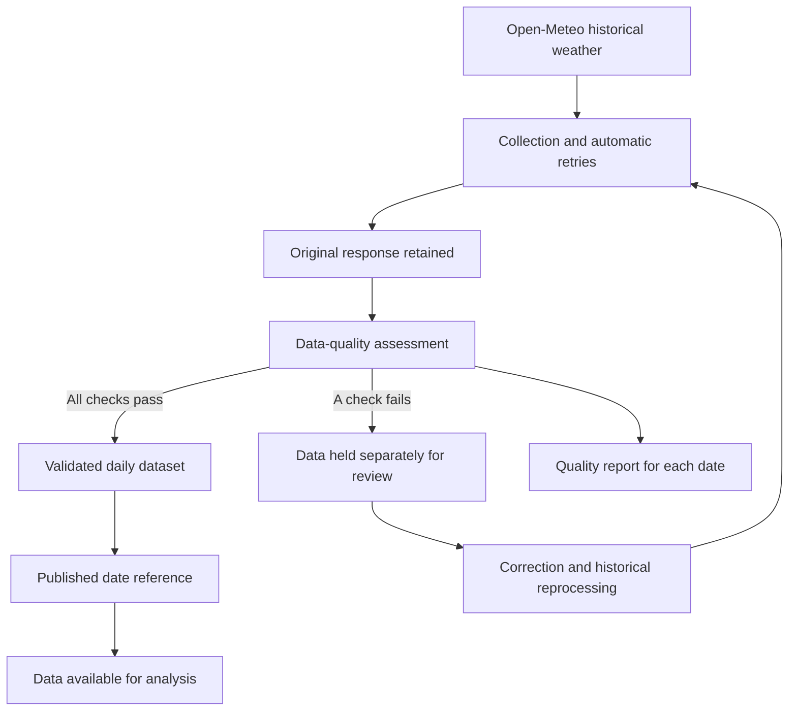

# Data flow and architecture

Weather observations pass through collection, quality assessment and publication. Only data that passes every required check becomes the published version for its date.

## Published dataset

The dataset contains one daily observation for New Delhi. Dates use UTC, temperatures use degrees Celsius and precipitation uses millimetres. Original responses and validated records are retained separately in object storage.

Each published date has a reference to its accepted dataset. That reference changes only after the replacement data has passed validation and been stored successfully. An unsuccessful replacement leaves the previous accepted version in place.

## Quality assessment

| Check | Publication requirement |
|---|---|
| Freshness | The observation matches the requested date |
| Missing values | All required values are present |
| Duplicate records | The date is unique within the daily dataset |
| Schema drift | Daily fields match the expected contract |
| Data types | Dates and weather values have the expected types |
| Row-count anomalies | Exactly one observation is present for the date |
| Weather ranges | Values satisfy the accepted bounds, maximum temperature is at least the minimum, and precipitation is nonnegative |

Freshness describes coverage of the requested observation date. Historical data is assessed against its historical date, so a valid backfill is not treated as stale because it is old.

## Historical collection

Each date is assessed and published independently. A problem with one date does not prevent other valid dates in the same run from being published. Reprocessing updates the published reference for the affected date without appending duplicate consumer records.

If successful collections for the same date overlap, the last publication becomes the accepted version. Demonstration data and public-source data have separate publication references.

## Platform

Python and Pandas perform collection and validation. Azure Blob Storage holds source responses, accepted datasets, publication references and quality reports; a local storage option provides the same layout. Docker packages the application, and GitHub Actions defines automated validation and container-release workflows.
